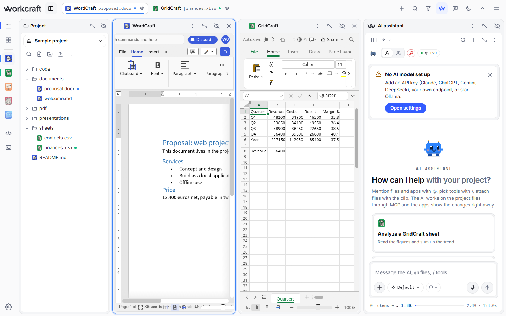
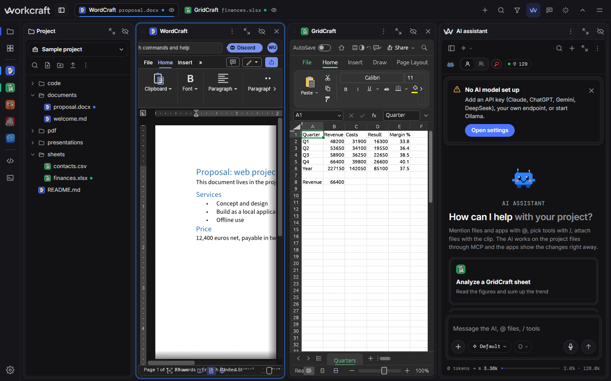

# WorkCraft

**A unified local-first workspace for real work.**

<p align="center">
  <a href="https://workcraft.cc/app/"><b>Use the workspace in your browser</b></a> (nothing to install)
  &nbsp;·&nbsp;
  <a href="#quick-start"><b>Run it yourself</b></a> (source, issues, self-hosting)
</p>

| | Use the workspace | GitHub (this repository) |
| :--- | :--- | :--- |
| For | anyone who wants to try or use WorkCraft | developers, contributors, people who host it themselves |
| Where | [workcraft.cc/app](https://workcraft.cc/app/) | you are here: [source](https://github.com/visoire/workcraft), [issues](https://github.com/visoire/workcraft/issues), [contributing](CONTRIBUTING.md), [self-hosting](docs/SELF-HOSTING.md) |
| Your files | stay in your browser | stay in a folder you own |
| Terminal, local models (Ollama), desktop apps | not in the browser version | yes, when you run it on your computer |

[](#license)
[](CHANGELOG.md)
[](https://nodejs.org/)
[](https://github.com/visoire/workcraft/actions/workflows/ci.yml)

<p align="center">
  
</p>
<p align="center">
  
</p>
<p align="center"><sub>The sample project, the empty AI assistant (no model is set up yet) and two of the four office apps. Screenshots of the real workspace.</sub></p>

> **Alpha software.** This is an alpha (`0.1.0-alpha.2`, after the first public alpha `0.1.0-alpha.1`); there is no stable release yet. Expect bugs, and expect settings and data formats to change between alphas. iPadOS support is built but not proven on a physical iPad. [Report what you find](https://github.com/visoire/workcraft/issues/new/choose).

Developers have long had editors where code, a terminal and the file tree sit side by side in one window. Everyone else still juggles separate heavy applications, loose browser tabs and cloud accounts that keep their files hostage. WorkCraft brings the single-window way of working to documents, spreadsheets, presentations and PDFs. Your files live in a folder you own, an AI assistant you control works across all of them, and nothing leaves your computer unless you decide it should.

Version **0.1.0-alpha.2** (alpha), licensed **MIT OR Apache-2.0**. Runs on Windows, macOS and Linux, and on iPadOS with Apple Pencil.

| | |
| :--- | :--- |
| **One workspace** | Write, calculate, present and sign in one window. Split it, maximize a panel, float one on top of the others or send it to the dock. Every panel keeps its state while you rearrange it. |
| **AI built in** | An assistant that reads and edits your documents, sheets, slides and PDFs, and shows each step so you can check and undo it. Private by default, local with Ollama, or your own key for DeepSeek, Claude, ChatGPT, Gemini and more. |
| **Private by default** | No account, no telemetry, no CDN, no upload. Files stay in a folder on your machine, API keys stay on the local server, and Local-only mode blocks every cloud provider with one switch. |
| **Every device** | Windows, macOS and Linux, and iPadOS with Apple Pencil, Magic Keyboard and sharp Retina rendering. Pair an iPad with your desktop over the home network, or work on the iPad alone. |
| **Open and growing** | Open source under MIT or Apache-2.0. The roadmap is open: more apps join the same workspace and the same assistant. |

---

## The three WorkCraft projects

| Project | What it is | Status |
| :--- | :--- | :--- |
| **WorkCraft workspace** (this repository, `visoire/workcraft`) | The main project: the open-source workspace with the AI assistant, Team mode, MCP, a catalog of 44 apps and cloud storage | Open source (MIT OR Apache-2.0), alpha |
| **WorkCraft home** (`visoire/workcraft-home`) | The website [workcraft.cc](https://workcraft.cc/): homepage, changelog page, portal, dashboard and website assistant. It also serves the browser version of this workspace at [workcraft.cc/app](https://workcraft.cc/app/) | Private, not open source |
| **[WorkCraft AI](https://github.com/visoire/workcraft-ai)** (`visoire/workcraft-ai`) | The AI chat and multi-agent app for the desktop only, in Rust (egui), with a CLI and an MCP server | Open source (MIT OR Apache-2.0), alpha |

Every GitHub repository the projects build on or learned from is listed in [SOURCES.md](SOURCES.md).

## Why WorkCraft

Real work is rarely one file. A report needs numbers from a spreadsheet, a chart for a slide, a signed PDF for the client. Today that means four applications, a dozen tabs, copies of copies, and an account somewhere that you must trust with all of it.

WorkCraft puts those pieces in one place:

- **One project, one folder.** Documents, sheets, slides and PDFs sit in a project on your own disk, with one file tree, one search and one undo history.
- **One window.** Panels sit side by side, so the numbers, the slide and the contract are visible together.
- **One assistant.** The same AI chat works in every panel, so "chart the Q3 numbers from the sheet on slide 3 and attach it to the contract" is one request.
- **No lock-in.** The files are standard formats (`.docx`, `.xlsx`, `.pptx`, `.pdf`, `.md`, `.csv`). Take them anywhere, any time.

## What is inside

| Panel | Use it for | Formats |
| :--- | :--- | :--- |
| **Documents** (WordCraft) | letters, reports, handbooks, notes | `.docx`, `.odt`, `.md`, PDF export |
| **Sheets** (GridCraft) | tables, budgets, analysis, charts | `.xlsx`, `.csv`, dynamic arrays |
| **Slides** (DeckCraft) | presentations and decks | `.pptx`, PDF export |
| **PDFs** (PdfCraft) | reading, organizing, local signing, redaction | PDF |
| **Files, search and history** | one tree for the whole project, snapshots, undo | any |
| **Code and terminal** | for the moments you need them: scripts and data prep | any |

The four office panels are the open-source apps WordCraft, GridCraft, DeckCraft and PdfCraft, running as WebAssembly (WebGPU, with WebGL2 as a fallback). The other 40 apps of the catalog run the same way (see [Workspaces for every kind of work](#workspaces-for-every-kind-of-work)).

## Workspaces for every kind of work

WorkCraft does not push all 44 apps into one crowded window. Each kind of work gets its own **workspace** (an ecosystem). The apps come from
three places: the ArtCraft team (17), community apps its launcher lists (SolidCraft, MailCraft) and 25 third-party apps of
a public collection of independent apps (see SOURCES.md), each with its own licence (the launcher shows it).

| Workspace | Apps |
| :--- | :--- |
| **Office & Documents** (default) | WordCraft, GridCraft, DeckCraft, PdfCraft, MailCraft |
| **Notes, Text & Maths** | NoteCraft, TextCraft, WordCraft, MatCraft |
| **Imaging & Photography** | PhotoCraft, LightCraft, LightCraft Classic, VectorCraft |
| **Paint & Pixel Art** | PaintCraft, Paint.RS, PixelCraft, ProCraft, FireCraft |
| **Video, Motion & Audio** | FilmCraft, EffectCraft, SoundCraft, AniCraft, Picasso Suite, Align |
| **Music Production** | SoundCraft, Retake, Lemon Studio, Honeydew, Suhina, Pro Wave, Transit, OxiGuitar, MixStudio |
| **Design, UI & Publishing** | DesignCraft, FigCraft, VectorCraft, TraceDraw |
| **3D, CAD & Materials** | CADCraft, TextureCraft, MaterialCraft, SolidCraft, SubCraft |
| **3D Sculpt & Characters** | OxyBrush, ClothCraft, HumanMotionCraft, SubCraft, TextureCraft |
| **Explore & Build** | EarthCraft, Craft Anything |
| **Your own** | any apps you choose (grouped by origin, with a search box) |

A first-run onboarding (a welcome, the workspace, and whether files also go to a cloud) asks where to start before anything loads; the grid button on the rail opens the launcher (the apps of the workspace, your recent files,
Keep these apps offline) and lets you switch. The files stay in the project, so the same file opens in every app that reads its type
(Open with in the tree). A link such as `/?ecosystem=imaging` opens a workspace directly. The four office apps ship with the
repository; all 40 remaining apps have web builds installed and registered in `public/web-builds.json` (44 of 44 total), in `versions/`: the four office web builds at the top (the only ones in this repository), the installed web builds of the other apps in `versions/web-builds/`, Rust source trees in `versions/<origin>/` (`artcraft`, `community`, `independent`) and, in `versions/zip/<origin>/`, only archives that no folder holds (a previous version kept for rollback). Nothing is kept twice; [docs/UPDATING.md](docs/UPDATING.md) has the layout.
`npm run versions` shows which version of every app is where and, with `--remote`, what GitHub has newer. `npm run apps:import` copies web builds from `versions/` into `public/<app>/`, patches known upstream browser issues (`scripts/patch-apps.mjs`), and writes `public/web-builds.json`.
MailCraft 0.13.0 (0.12.0's web build panicked in the browser; 0.13.0 does not), SolidCraft 0.43.0, SubCraft 0.3.6, Honeydew 0.5.3 and Paint.RS 0.7.3 start cleanly with WorkCraft's runtime shims and WebGPU/WebGL2 fallback. Lemon Studio needs cross-origin isolation. Details, update steps and what is verified: [docs/ECOSYSTEMS.md](docs/ECOSYSTEMS.md).
## AI, built in

The assistant is a core part of the workspace, not an add-on, and it follows the same rule as everything else: your data stays yours.

- **Private by default.** Nothing is sent anywhere until you add a model. Every request that does leave the machine is listed in a local audit log (destination, model, size, attached file names, never contents).
- **Local models with Ollama.** Run models on your own hardware: completely air-gapped, zero cost per request, no key. Local-only mode blocks every cloud provider with one switch.
- **Your own keys, your own choice.** Optional support for Claude, ChatGPT, Gemini, DeepSeek, Grok, GLM, Mistral, Groq, OpenRouter, Together AI, LM Studio and any OpenAI-compatible endpoint, with native adapters, reasoning streams, prompt caching and exact token counts per model. Switching the model never changes your files.
- **It works inside your files.** Through the Model Context Protocol (MCP) the assistant reads and writes sheets and documents, creates slides, reads and signs PDFs, turns images into a PDF, searches the project and opens panels. Each call is validated before it runs, shown as a step you can inspect, and covered by snapshots and undo.
- **Single or Team mode.** Switch in the chat header. In Team mode a Team Leader plans the task and agents work together: supervisor and workers, sequential, parallel, or human in the loop (you approve the plan first). Create your own agents with a role, prompt, model, tools, color and icon, give the team a shared memory, address agents with @name, and watch what each one is doing. Writes to the same file wait in line, reads never do.
- **Open tools, both directions.** The same tools are served at `/mcp`, so Antigravity, Trae, Cursor, Claude Code or any MCP client can work in your projects too (ready snippets under Settings, Connect other IDEs). WorkCraft is also an MCP client: it connects the Craft apps on your computer (photos, vector art, video, audio, CAD and more) and your own servers, and reads the 13 skills that explain how to drive them.
- **Fewer tokens.** The model gets the tools the question needs (an app's tools when the question is about that app, the rest one `find-tools` call away), older tool results and attachments shrink behind the question, a team reviews with the leader model only what the checks doubt, and a short request about one app goes straight to that specialist. Every answer shows what was saved; the cache of each provider keeps hitting because the prompt prefix stays stable ([docs/AI-TOKENS.md](docs/AI-TOKENS.md)).
- **Voice input.** A microphone next to Send turns speech into text in the draft, offline with [Handy](https://github.com/cjpais/Handy) on your computer (Whisper, Parakeet, Nemotron models) or with the speech recognition of the browser; "at gridcraft" becomes @gridcraft ([docs/VOICE.md](docs/VOICE.md)).
- **Cloud when you want it, on this computer or only in the browser.** Keep a project local only, in Google Drive (your own OAuth client), in iCloud Drive or any synced folder, or in both places with two-way sync and conflict copies, and open a cloud project on another device; the AI opens and saves Google Docs, Sheets and Slides. Browser mode (the iPad alone) has the same Settings page: Google Drive from the browser, and a folder of the computer in Chrome and Edge. Local-only mode blocks it.

Details: [docs/AI-SUPPORT-REFERENCE.md](docs/AI-SUPPORT-REFERENCE.md) (the working reference for providers, teams, skills, MCP, IDE bridge and cloud), [docs/AI-PROVIDERS.md](docs/AI-PROVIDERS.md) and [docs/MCP-TOOLS.md](docs/MCP-TOOLS.md).

## Platforms

- **Windows, macOS and Linux.** WorkCraft runs on your computer: the interface in your browser, a small Node.js server on `127.0.0.1`, and your files in a folder you own. The individual apps also ship as portable Windows builds (x64, x86, ARM64); builds for macOS and Linux are on their GitHub pages.
- **iPadOS.** Touch, Apple Pencil with pressure and tilt, Magic Keyboard shortcuts, Stage Manager, and the apps rendered 1:1 at the iPad's Retina resolution. Pair the iPad with your desktop over Wi-Fi, or use browser mode on the iPad alone. See the [iPadOS guide](docs/IPADOS-GUIDE.md).

## Roadmap

The roadmap is open and expanding. Documents, sheets, slides, PDFs, the assistant and the providers come first, and each step has to be usable before the next begins. More apps and a wider ecosystem are planned for the same workspace and the same assistant. Follow the [changelog](CHANGELOG.md) and the issues on GitHub.

---

## Quick start

### In your browser

Open [workcraft.cc/app](https://workcraft.cc/app/). **All 44 apps and every workspace are there** (Office, Imaging, Paint, Video and Audio, Music, Design, 3D and CAD and more). Nothing is installed and nothing is uploaded: your projects live in your browser, and an AI key you type stays in memory until you reload. The terminal, local models (Ollama) and the desktop Craft apps are not available there; for those, run WorkCraft on your computer. To host the browser version yourself, see [docs/SELF-HOSTING.md](docs/SELF-HOSTING.md).

### Run it yourself

You need **Node.js 22 or newer** (reading PDFs on the server needs the `Iterator` global of Node 22). Git is only needed to clone the repository. `node-pty` is optional: with it the terminal is a full terminal; without it, each line runs as a command in PowerShell, cmd.exe or `/bin/sh`.

### Windows, macOS and Linux

```sh
git clone https://github.com/visoire/workcraft.git
cd workcraft
npm install
npm run dev
```

Open `http://localhost:5175/`. You start in an empty project of your own (**My project**). Import your files, or press **Load sample data** to open a separate sample project with a document, a spreadsheet, a presentation and a PDF; your own project stays untouched. Add a model under Settings, **AI models**: an API key, your own endpoint, or Ollama for fully local work.

**All 44 apps on your computer.** This repository contains the four office apps (WordCraft, GridCraft, DeckCraft, PdfCraft). The other 40 come from their own repositories and licences (ten are GPL-3.0), so they are not part of it. Until you install them, their panels say "No web build here yet". One command lists what is available and installs the official web build of each:

```sh
npm run apps:fetch               # lists every app, its version and size (downloads nothing)
npm run apps:fetch -- --yes      # installs them all (about 1.5 GB); add --app photocraft,filmcraft for only some
```

Then restart `npm run dev`. Without installing anything, [workcraft.cc/app](https://workcraft.cc/app/) has all of them. Details: [docs/ECOSYSTEMS.md](docs/ECOSYSTEMS.md) and [docs/UPDATING.md](docs/UPDATING.md).

On Windows, PowerShell and Command Prompt both work, and the terminal panel lets you switch between them. On macOS and Linux the terminal uses your `$SHELL`.

| Command | What it does |
| :--- | :--- |
| `npm run dev` | Backend (Hono, port 5176) and Vite (port 5175) with hot reload. The workspace is at `http://localhost:5175/`. It also shares WorkCraft on your home network: the output prints the pairing address for the iPad (`http://192.168.x.x:5175/pair?token=...`). `npm run dev:local` listens on this computer only. |
| `npm run dev:lan` | The same as `npm run dev`. Add `-- --https` for HTTPS. |
| `npm run lan:cert` | Makes the HTTPS certificate for the home network with [mkcert](https://github.com/FiloSottile/mkcert), see the iPadOS guide. |
| `npm run build` | Frontend, every installed app (the four office apps, plus the others you installed with `npm run apps:fetch`), the service worker list and the server into `dist/` and `dist-server/`. |
| `npm start` | Production server from the build on `http://localhost:5175/` (opens the browser), shared on your home network like `npm run dev`. `npm run start:local` listens on this computer only. |
| `npm run start:lan` | The same as `npm start`. `-- --https` serves the mkcert certificate: WebGPU, offline cache and OPFS on the iPad. |
| `npm run typecheck` | Strict TypeScript for frontend and backend. |
| `npm test` | Backend integration tests (files, projects, terminal, AI routing, MCP, Team Mode, releases). |
| `npm run test:e2e` | Playwright end to end with a mock model (see [Tests](#tests)). |
| `npm run check:clean` | Blocks API keys, private files, database files and brand assets before a commit. |

### iPadOS

1. On your desktop, run `npm run dev` (or `npm run build` and `npm start`). Both share WorkCraft on your home network and print the pairing address; the first time, allow Node.js on private networks in the Windows firewall prompt.
2. Scan the QR code under Settings, iPad and network with the iPad camera (or open the pairing link it prints, `http://<your PC>:5175/pair?token=...`) once in Safari.
3. From then on, `http://<your PC>:5175/` opens WorkCraft with your desktop projects. Share, **Add to Home Screen** makes it a full-screen app.

For WebGPU, the offline cache and fast storage on the iPad, serve HTTPS: `npm run lan:cert`, trust the certificate on the iPad once, then `npm run start:lan -- --https`.

Without a desktop, WorkCraft runs in browser mode with projects stored on the iPad. See the [iPadOS guide](docs/IPADOS-GUIDE.md). New app releases keep working on the iPad because the iPadOS layer checks what an app does, not its version: [compatibility layer](docs/IPADOS-COMPAT.md).

### Your data and API keys

Your data lives in `~/workcraft` (on Windows `C:\Users\<name>\workcraft`, change it with `WORKCRAFT_HOME`): one folder per project, chats and history in `<project>/.workcraft/`, settings and API keys in `config.json`. Nothing of it is ever part of this repository.

Coming from an earlier version under the former name? WorkCraft renames an existing `~/WorkCraft` or `~/OpenCraft` folder (or uses `OPENCRAFT_HOME`) to `~/workcraft` on the first start, and keeps using it in place when it cannot be renamed. It also renames the `.opencraft` folder inside each project to `.workcraft` on the first start, and copies the browser settings it finds. Nothing is deleted.

- **Desktop:** API keys are stored by the local server in `config.json` (mode `0600` on macOS and Linux), outside the reach of scripts in the page. The browser only sees a masked hint, and a key is only sent to the provider it belongs to.
- **iPad in browser mode:** keys stay in memory until you reload. Keeping them in the browser's storage is an opt-in behind a clear warning.

### Updates

WorkCraft can tell you when it, or one of its apps, is older than its newest GitHub release. The check is off until you switch it on under Settings, Updates. It uses the release logic of apicraft built into the workspace and asks GitHub directly, so there is no extra server or key; an optional GitHub token lifts the 60 requests per hour limit. Only repository names and version numbers are sent.

The user documentation opens from the WorkCraft menu, or at `http://localhost:5175/docs/`.

### Guides

| Guide | Covers |
| :--- | :--- |
| [docs/README.md](docs/README.md) | where to start, by role: user, contributor, maintainer |
| [docs/SELF-HOSTING.md](docs/SELF-HOSTING.md) | the three ways to run WorkCraft, and hosting the browser version on your own web server |
| [docs/ARCHITECTURE.md](docs/ARCHITECTURE.md) | browser and server halves, channels, data on disk, key storage, zero CDN, security boundaries |
| [docs/MCP-TOOLS.md](docs/MCP-TOOLS.md) | every tool with its arguments, approvals, using the tools from Claude Code or other clients, adding a tool |
| [docs/AI-PROVIDERS.md](docs/AI-PROVIDERS.md) | Claude, ChatGPT, Gemini, DeepSeek, Grok, GLM, Mistral, Groq, OpenRouter, Together AI, Ollama, LM Studio and custom endpoints, reasoning, caching, token counts, Team Mode |
| [docs/AI-SUPPORT-REFERENCE.md](docs/AI-SUPPORT-REFERENCE.md) | the working AI reference: wire formats per provider, thinking and signatures, caching, Ollama, teams and patterns, skills, Craft apps, IDE bridge, cloud, release check |
| [docs/AI-TOKENS.md](docs/AI-TOKENS.md) | where the tokens of a request go, what WorkCraft leaves out, what every provider caches and discounts, choosing models for a team |
| [docs/VOICE.md](docs/VOICE.md) | voice input: Handy, the browser engine, @ and / by voice, iPad, setup and troubleshooting |
| [docs/THEMING.md](docs/THEMING.md) | light and dark mode per app: what follows the switch, what keeps its own look, the CSS bridge, how to add an app, the audit scripts |
| [docs/ECOSYSTEMS.md](docs/ECOSYSTEMS.md) | workspaces (ecosystems), shared storage and recent files, web builds and how to update them, iPad traits |
| [docs/UPDATING.md](docs/UPDATING.md) | the step-by-step guide to update every app or add a new one (versions folder, manifests, catalog, MCP, docs, checks, rollback), written for AI agents too |
| [docs/IPADOS-GUIDE.md](docs/IPADOS-GUIDE.md) | pairing over Wi-Fi, HTTPS, browser mode, Apple Pencil, Magic Keyboard, Retina, memory, limits |
| [docs/IPADOS-COMPAT.md](docs/IPADOS-COMPAT.md) | the iPadOS compatibility layer: register of measures, engine contract, new engine releases |
| [docs/PUBLISHING.md](docs/PUBLISHING.md) | for maintainers: publishing and releasing on GitHub |
| [docs/LEGAL.md](docs/LEGAL.md) | licenses, trademarks and notices |
| [SOURCES.md](SOURCES.md) | every GitHub repository the project builds on, ships, connects to or learned from |
| [CHANGELOG.md](CHANGELOG.md) | every release, newest first |

---

## Architecture

```
Browser                                              Your machine
┌──────────────────────────────────────────┐        ┌───────────────────────────────┐
│ app/  workspace shell (TypeScript, Vite)  │ REST   │ src/server/  Hono on 127.0.0.1 │
│  ├ panels: WordCraft GridCraft DeckCraft  │◄──────►│  files, projects,              │
│  │         PdfCraft (WebAssembly iframes) │  SSE   │  terminal, AI router,          │
│  ├ code editor, terminal, settings        │  WS    │  MCP server (/mcp), search,    │
│  └ AI chat, Full Chat Mode, Team Mode     │  MCP   │  memory, snapshots, audit      │
│     └ MCP orchestrator (src/mcp/)         │        │        │                      │
└──────────────────────────────────────────┘        │        ▼                      │
                                                     │  ~/workcraft (your files)     │
                                                     └───────────────────────────────┘
```

| Channel | Use |
| :--- | :--- |
| REST `/api/*` | files, projects, settings, chats, layout, usage |
| SSE `/api/ai/chat` | token streaming from the AI router, including native tool calls |
| WebSocket `/ws` | live file events for panel sync, terminal I/O, tool activity |
| MCP `/mcp` | Streamable HTTP MCP server with all project tools, also for external MCP clients |

### The apps

| App | Accent | Hex | Formats |
| :--- | :--- | :--- | :--- |
| **WorkCraft** (workspace) | Blue | `#335CFF` | projects, chat, code |
| **WordCraft** | Blue | `#3B82F6` | `.docx`, `.odt`, `.md` |
| **GridCraft** | Green | `#10B981` | `.xlsx`, `.csv`, dynamic arrays |
| **DeckCraft** | Orange | `#F97316` | `.pptx`, vector morph |
| **PdfCraft** | Teal | `#14B8A6` | PDF: deep zoom, local signing, redaction |

The accents appear only on app marks. Surfaces are monochrome: warm light paper or a deep carbon dark theme, with quiet `.frame` and `.well` borders.

### App releases

| App | Version | Released | Web build (`versions/`) | Web zip (`versions/zip/`) | Windows portable x64 / ARM64 |
| :--- | :--- | :--- | :--- | :--- | :--- |
| **WordCraft** | `0.18.1` | 2026-11-12 | `wordcraft-web-0.18.1/` (58.5 MB) | 21.5 MB | 112.5 / 109.2 MB |
| **GridCraft** | `0.19.1` | 2026-11-12 | `gridcraft-web-0.19.1/` (25.4 MB) | 9.2 MB | 49.7 / 47.8 MB |
| **DeckCraft** | `0.18.1` | 2026-11-12 | `deckcraft-web-0.18.1/` (31.9 MB) | 11.4 MB | 99.6 / 96.7 MB |
| **PdfCraft** | `0.21.1` | 2026-11-12 | `pdfcraft-web-0.21.1/` (73.0 MB) | 32.8 MB | 117.4 / 112.3 MB |

`public/releases.json` is the one place release data lives. The build, the dev server and the workspace registry read it; `tests/server/releases.test.ts` checks this table, the service worker and the web builds against it. Every web build is unmodified upstream. DeckCraft 0.9.0 needed a startup fix ([storytold/deckcraft#959](https://github.com/storytold/deckcraft/issues/959)); DeckCraft 0.11.1 and every later build no longer do, so `releases.json` lists no patches. `scripts/patch-apps.mjs` stays for a future build that needs one.

---

## Keyboard shortcuts and chat operators

`Ctrl` on Windows and Linux, `Cmd` on macOS and on an iPad with a Magic Keyboard.

| Shortcut | Does |
| :--- | :--- |
| `Ctrl/Cmd+K` | command palette: every action is in it (chat, Full Chat Mode, search, picture in picture, focus mode, top bar, minimize, maximize) |
| `Ctrl/Cmd+\` | project tree |
| `Alt+Enter` | full screen for the focused panel |
| `Alt+\` | AI completion at the cursor in the code editor (`Tab` accepts, `Escape` dismisses) |
| `Enter` / `Shift+Enter` | send the chat message / new line |

| Operator | Examples | Does |
| :--- | :--- | :--- |
| `@` file or folder | `@finances.xlsx`, `@sheets/` | attaches the content: sheets as Markdown tables, documents and PDFs as text, folder listings |
| `@` app or panel | `@wordcraft`, `@gridcraft`, `@deckcraft`, `@pdfcraft`, `@terminal` | attaches the panel state and points the model at that app's tools |
| `@` agent | `@team`, `@leader`, `@grid-agent`, `@word-agent`, `@deck-agent`, `@pdf-agent`, `@dev-agent`, `@photocraft-agent` and one `@<app>-agent` per app | runs Team Mode, or gives the prompt to one specialist |
| `/` tool | `/read-sheet`, `/write-document`, `/create-slide`, `/sign-pdf` | forces an MCP tool; with complete arguments it runs without a model: `/read-sheet @finances.xlsx range=A1:E6` |
| `/` command | `/clear`, `/new`, `/history`, `/export-chat`, `/search`, `/model`, `/persona`, `/context`, `/remember`, `/memory`, `/undo`, `/snapshot`, `/find`, `/team`, `/roster`, `/help` | chat, memory, history and team commands |

---

## Light and dark mode, language

The workspace has its own light or dark choice, stored as `oc-ide-theme` (plus the cookie `oc_ide_theme`). The top bar, the chat history and Settings all change the same value, and the apps inside the panels switch in place, without a reload and without losing the open document. An app opened on its own (`/apps/<app>/`) and the docs page follow the separate website choice `oc-home-theme`.

The interface is English by default. German is optional under Settings, Appearance and layout, **Language of the interface** (stored as `oc-ide-lang`).

---

## Tests

```sh
npm run typecheck
npm test
npm run test:e2e        # needs Playwright: npm i -D playwright (or PLAYWRIGHT_MODULE=<path to playwright-core>)
npm run test:ipad       # WebKit at iPad Pro sizes (npx playwright install webkit)
npm run check:clean
npm run build
```

The end-to-end test starts its own backend and Vite on ports 5185 and 5186 with an empty temporary data folder and an OpenAI-compatible mock model on 5299, so your own `~/workcraft` is never touched. Set `CHROMIUM` to a Chrome or Edge executable to use an installed browser. The unit tests (`npm test`) include `tests/server/ecosystems.test.ts` for the catalog, file routing, recent files, the storage bridge and the fetch script. The end-to-end test covers the `@` and `/` menus, custom endpoints and DeepSeek, the GridCraft to WordCraft to DeckCraft tool chain with live panel updates, validation and self-correction, panel layouts without losing WebAssembly state, projects, export, Team Mode, the theme scopes and the custom controls.

---

## Versioning and rules for AI coding agents

The project is in its **alpha phase**: versions look like `0.1.0-alpha.N`, the first public one is `0.1.0-alpha.1`, and there is no stable release
yet. The maintainer decides when a version is cut. Until then every change adds to `## [Unreleased]` in `CHANGELOG.md`. Do this in the same change as the
code, without being asked:

1. **Describe it.** Add a line (or a few) under `## [Unreleased]` at the top of `CHANGELOG.md`: what changed and why it matters to a user, in plain words,
   what is verified and what is not. Never rewrite a released entry.
2. Update every Markdown file that describes the change: `README.md`, `AGENTS.md`, `docs/*.md`, `src/docs/content.md`
   (the in-app documentation) and, for interface text, `src/app/i18n-de.ts`. `npm run check:docs` checks the links.
3. Update `SOURCES.md` when a dependency, engine, protocol, SDK or idea from another repository is added.
4. Run typecheck, test, check:clean, check:docs and build (and test:e2e when the interface changed) before you say it is done.

**Cutting a release is the maintainer's job** (or an agent asked to prepare one): `[Unreleased]` becomes `## [0.1.0-alpha.N] - YYYY-MM-DD`, and the number
changes in `package.json`, `package-lock.json` (two places), `src/core/version.ts` and the version line of `README.md`
(`tests/server/projects.test.ts` keeps `version.ts` and `package.json` equal); `docs/releases/<version>.md` holds the release notes
(`docs/PUBLISHING.md`). Do not raise the version in an ordinary change. The website (a private project) takes the same version in its own files.

The reasoning behind `0.1.0-alpha.1` is at the top of [CHANGELOG.md](CHANGELOG.md).

## Architecture and context map for AI coding agents

Read [AGENTS.md](AGENTS.md) before you change anything; it is the full version of this map.

```
index.html                 workspace entry (the page that loads src/app/main.ts)
docs/index.html           user documentation page (src/docs/)
docs/*.md                 guides (docs/README.md is the map): ARCHITECTURE, SELF-HOSTING, MCP-TOOLS, AI-PROVIDERS, AI-SUPPORT-REFERENCE, IPADOS-GUIDE, IPADOS-COMPAT, ECOSYSTEMS, UPDATING, THEMING, LEGAL, PUBLISHING
skills/                   the 13 artcraft-skills (agentskills.io format), read by the assistant with read-skill
SOURCES.md, CHANGELOG.md  every GitHub source; every alpha version
src/app/                  shell: main.ts (entry, top bar, rail, keys), settings.ts (prefs), theme-store.js,
                          i18n.ts + i18n-de.ts, select.ts (dropdown), ui.ts (dialogs, menus), palette.ts
src/workspace/            layout.ts (window manager), registry.ts (tools), pip.ts, pencil.ts,
                          panels/ (craftapp.ts, code.ts, terminal.ts, settings.ts, settings-connect.ts)
src/ipados/               iPadOS layer: compat.ts (register), adapter.ts, capabilities.ts, memory.ts, opfs.ts, pen-calibration.ts
src/chat/                 sidebar.ts (chat views), agent.ts (tool loop), team*.ts and agents-ui.ts (Team mode,
                          agents you create), adapters/ (Claude, Gemini, OpenAI, Ollama), providers.ts, models.ts
src/mcp/                  schemas.ts (all tools, Zod), orchestrator.ts, locks.ts, panel-server.ts
src/project/              project manager, file mirror, tree
src/server/               Hono backend: index.ts (routes, CSP), ai.ts, tools.ts, terminal.ts, mcp.ts (server and
                          client), craft.ts, skills.ts, cloud.ts, bridge.ts, apicraft.ts, ...
src/core/                 shared without DOM or Node: search, sync, Markdown, BPE tokenizer
src/styles/               tokens.css, base.css, workspace.css, tools.css
public/                   craft-theme.js and craft-frame.js (run inside the apps), sw.js, releases.json
versions/                 the four engine web builds (wordcraft-web-*, ... tracked byte for byte, see .gitattributes); other web builds are fetched, not tracked
scripts/                  dev.mjs, copy-apps.mjs, patch-apps.mjs, precache.mjs, check-clean.mjs, ...
tests/                    server/*.test.ts (node:test via tsx), e2e.mjs, e2e-features.mjs, e2e-ipad.mjs
```

| Rule | Where |
| :--- | :--- |
| Theme of the workspace is `oc-ide-theme` / cookie `oc_ide_theme`; the website and standalone apps use `oc-home-theme` / `oc_home_theme`. Always pass the scope to `readTheme`, `writeTheme`, `watchTheme`. | `src/app/theme-store.js`, `public/craft-theme.js` |
| Interface prefs live in `localStorage` `workcraft.prefs`; change them with `prefs.set`, listen on the bus event `settings:change`. | `src/app/settings.ts`, `src/app/bus.ts` |
| English text is the i18n key: `t('Open settings')`. Add the German entry to `i18n-de.ts`. Server messages, MCP descriptions and model context stay English. | `src/app/i18n.ts` |
| Tools are defined once in `TOOL_DEFS` (Zod). Never reorder existing tools (prompt cache), keep descriptions English, set `pathArg`, `writes` and `approval`. Validate with `validateArgs`. | `src/mcp/schemas.ts` |
| Never import from `public/` in `src/`; release data arrives as `__OC_RELEASES__`. | `vite.config.js` |
| Panels reposition iframes, they never re-parent them (that would restart the WebAssembly app). | `src/workspace/layout.ts`, `pip.ts` |
| Never run tests against the dev server on 5175/5176: it uses the real `~/workcraft`. | `tests/e2e.mjs` |

---

## Contributors

- **visoire** ([github.com/visoire](https://github.com/visoire)): creator, lead maintainer and architect of WorkCraft.
- **storytold, the ArtCraft Team and contributors** ([github.com/storytold](https://github.com/storytold)): creators of the open-source engines WordCraft, GridCraft, DeckCraft and PdfCraft.
- **Claude** (Anthropic): AI fullstack architecture, systems engineering and code pairing.

See [CONTRIBUTORS.md](CONTRIBUTORS.md) and [CONTRIBUTING.md](CONTRIBUTING.md) to join in. Security problems: [SECURITY.md](SECURITY.md).

---

## Upstream Engine Separation and License Attribution

WorkCraft maintains a strict architectural and organizational separation between the WorkCraft workspace and the embedded crafting engines:
- **WorkCraft Workspace:** WorkCraft provides the workspace shell, window management, multi-split and picture-in-picture window manager, project file tree, local companion server (Hono on `127.0.0.1`), terminal, project snapshots, and the Model Context Protocol (MCP) orchestration layer that coordinates automated workflows. WorkCraft codebase is open source under `MIT OR Apache-2.0`.
- **Embedded Crafting Engines:** WordCraft, GridCraft, DeckCraft, and PdfCraft are independent open-source engines developed by storytold, the ArtCraft team, and contributors ([github.com/storytold](https://github.com/storytold)) under their respective open-source licenses (`MIT OR Apache-2.0`).
- **Notice Preservation:** All upstream copyright notices, author credits, and license files are maintained intact in every distribution under `versions/` and in the built site.

---

## Trademark and Compatibility Disclaimers

- **Independent Community Project:** WorkCraft is an independent project and is **not affiliated with, endorsed by, or sponsored by Adobe Inc., Microsoft Corporation, or their affiliates**.
- **Ownership of Trademarks:** All product names, logos, and brands (such as Microsoft Word, Microsoft Excel, Microsoft PowerPoint, Adobe Acrobat, Adobe Photoshop, and others) are the property of their respective owners. Their mention in this repository does not imply any affiliation, sponsorship, or endorsement.
- **Technical File Format Compatibility:** References to standard file formats (`.docx`, `.xlsx`, `.pptx`, `.pdf`) are used **solely for technical compatibility and interoperability descriptions** under nominative fair use.
- **Upstream & AI Marks:** ArtCraft, WordCraft, GridCraft, DeckCraft, and PdfCraft belong to storytold and the ArtCraft team. Claude, ChatGPT, Gemini, DeepSeek, and Ollama are trademarks of their respective owners.

---

## As-Is Provision, Limitation of Liability, and DMCA Contact

- **As-Is Provision:** THE SOFTWARE IS PROVIDED "AS IS", WITHOUT WARRANTY OF ANY KIND, EXPRESS OR IMPLIED, INCLUDING BUT NOT LIMITED TO THE WARRANTIES OF MERCHANTABILITY, FITNESS FOR A PARTICULAR PURPOSE, AND NONINFRINGEMENT. IN NO EVENT SHALL THE AUTHORS, CONTRIBUTORS, OR COPYRIGHT HOLDERS BE LIABLE FOR ANY CLAIM, DAMAGES, OR OTHER LIABILITY.
- **Intellectual Property & Takedown Notices:** Rights holders may submit inquiries or notices of claimed infringement to our designated contact:
  - **Email:** [visoire@proton.me](mailto:visoire@proton.me)
  - **Subject:** `[IP Notice] WorkCraft`
  - See [docs/LEGAL.md](docs/LEGAL.md) for full legal text and takedown procedures.

---

## License

WorkCraft is licensed under either of [MIT](LICENSE-MIT) or [Apache-2.0](LICENSE-APACHE) at your option (see [LICENSE](LICENSE)). The four apps in `versions/` keep their own MIT or Apache-2.0 license files in each app folder. The other 40 apps of the catalog are not part of this repository: each has its own author and licence (ten are GPL-3.0), listed in [docs/LEGAL.md](docs/LEGAL.md), Appendix A. WordCraft, GridCraft, DeckCraft and PdfCraft are Crafting Apps by the ArtCraft team; the ArtCraft name and logos are trademarks of their owners and are not part of this repository. WorkCraft is an independent community project and is not affiliated with Microsoft or Adobe; Word, Excel, PowerPoint and Acrobat are trademarks of their owners.
